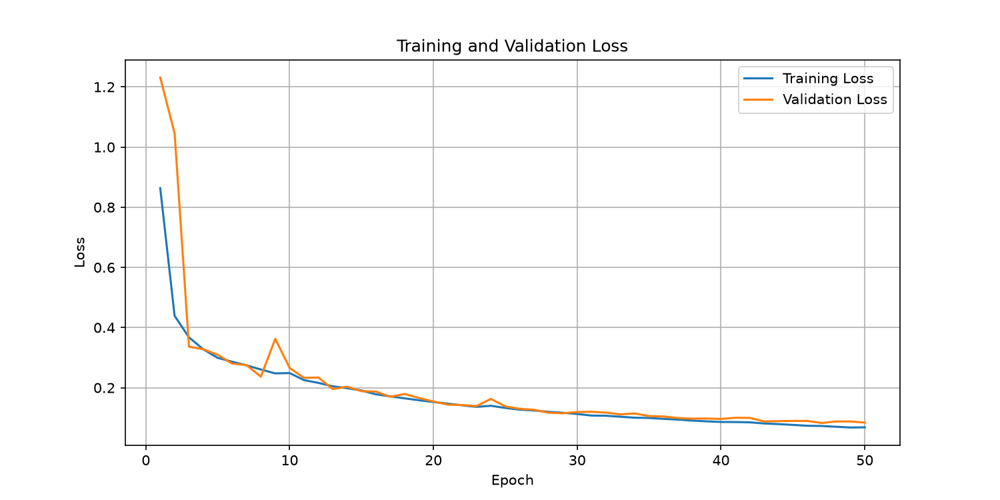
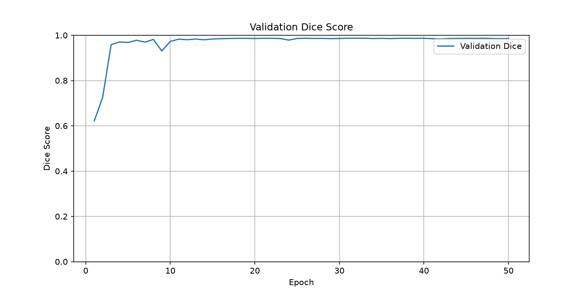
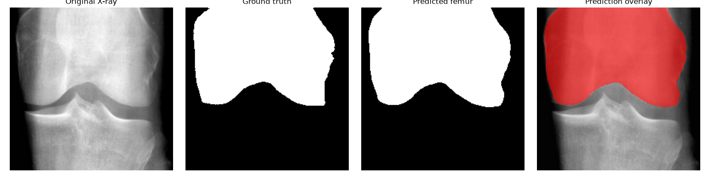
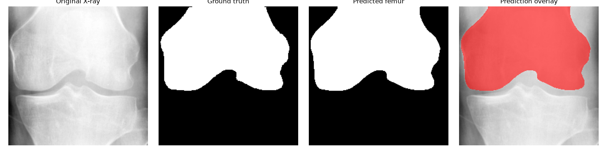
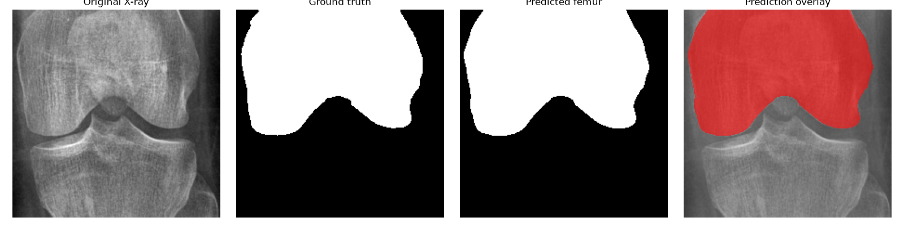
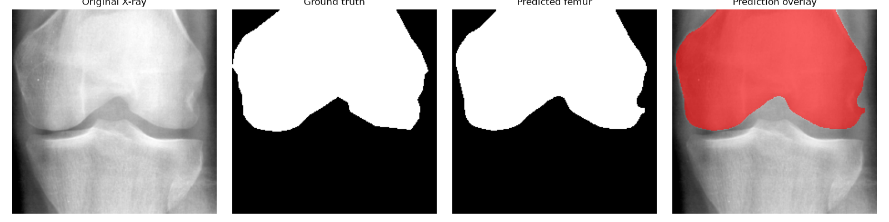
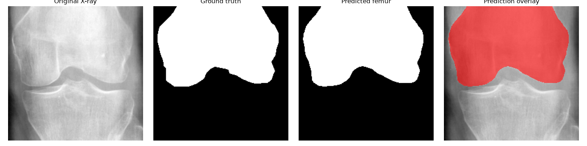
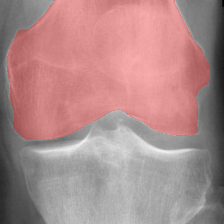
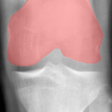
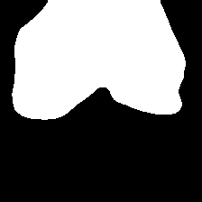

# Knee X-ray Femur Segmentation Using U-Net

## 1. Project Overview

This project focuses on automatic femur segmentation in knee X-ray images using a U-Net convolutional neural network (CNN).

The main objective is to develop a deep learning model that can identify and segment the femur region from grayscale knee X-ray images.

The project was developed as part of the **SAMK Image Segmentation with CNNs** course.

The implementation uses PyTorch and a U-Net architecture with an encoder-decoder structure and skip connections.

## 2. Project Objectives

- Understand and implement a U-Net architecture.
- Load and preprocess knee X-ray images and segmentation masks.
- Train a CNN to segment the femur.
- Evaluate model performance using the Dice score.
- Visualize predicted segmentation masks.
- Generate predictions for separate test X-ray images.

## 3. Dataset

The dataset contains 150 knee X-ray images.

| Dataset | Number of images | Ground-truth masks |
|---|---:|---|
| Development dataset | 100 | Yes |
| Training set | 80 | Yes |
| Validation set | 20 | Yes |
| Separate test set | 50 | No |

The 100 annotated development images are divided into:
- 80 training images.
- 20 validation images.

The separate test dataset contains 50 X-ray images without ground-truth segmentation masks.

The dataset is organized into image, mask and CSV files. CSV files contain the corresponding image and mask paths.

**Important:** The original dataset and annotation archives are not included in this public repository. They must be obtained separately with the appropriate permissions.

## 4. U-Net Architecture

The project uses U-Net, a convolutional neural network architecture designed for image segmentation.

The architecture consists of four main components:

### Encoder
Extracts image features through convolutional layers and downsampling.

### Bottleneck
Captures deeper and more complex image features.

### Decoder
Reconstructs spatial information and generates the segmentation output.

### Skip Connections
Transfer information from encoder layers to corresponding decoder layers. This helps preserve spatial details and improve segmentation boundaries.

### Model Configuration

- Input channels: 1 (grayscale X-ray)
- Output channels: 1 (binary segmentation mask)
- Activation in output: Raw logits
- Prediction threshold: 0.5 after sigmoid
- Architecture: U-Net

## 5. Project Structure

```text
segmentation_project/
│
├── dataset/
│   ├── xrays/
│   ├── masks/
│   └── CSVs/
│       ├── dataset.csv
│       ├── train.csv
│       ├── validation.csv
│       └── test.csv
│
├── results/
│   ├── training_loss.png
│   ├── validation_dice.png
│   ├── 148.png
│   ├── 149.png
│   ├── 149_mask.png
│   └── validation/
│       ├── sample_0.png
│       ├── sample_1.png
│       ├── sample_2.png
│       ├── sample_3.png
│       └── sample_4.png
│
├── checkpoints/
│
├── args.py
├── create_csv.py
├── dataset.py
├── evaluate.py
├── main.py
├── model.py
├── plot_csv_counts.py
├── trainer.py
├── utils.py
│
├── dataset_split_bar_chart.png
├── requirements.txt
├── .gitignore
└── README.md
```

**Note:** The dataset and checkpoint directories are excluded from the public repository through `.gitignore`.

## 6. Technologies and Libraries

- Python
- PyTorch
- OpenCV
- NumPy
- Pandas
- Matplotlib
- Convolutional Neural Networks
- U-Net

## 7. Installation

### Clone the repository

```bash
git clone YOUR_GITHUB_REPOSITORY_URL
cd segmentation_project
```

### Create a virtual environment

```bash
python3 -m venv .venv
```

### Activate the environment

```bash
source .venv/bin/activate
```

### Install dependencies

```bash
pip install -r requirements.txt
```

### Dataset preparation

Obtain the dataset separately and organize it according to the expected directory structure.

The CSV files should contain the following columns:

- `xrays`: path to the X-ray image.
- `masks`: path to the corresponding segmentation mask.

The expected CSV files are:

- `dataset/CSVs/train.csv`
- `dataset/CSVs/validation.csv`
- `dataset/CSVs/test.csv`

The test CSV contains paths to test X-ray images without ground-truth masks.

## 8. Training Configuration

The training configuration is defined in `args.py`.

Current experiment settings:

| Parameter | Value |
|---|---:|
| Batch size | 4 |
| Learning rate | 0.0001 |
| Epochs | 50 |
| Input channels | 1 |
| Output channels | 1 |
| Device | CPU |

These parameters can be adjusted in `args.py`.

## 9. Running the Project

Run the complete pipeline:

```bash
python main.py
```

The main pipeline performs the following steps:

1. Loads the training and validation datasets.
2. Creates DataLoaders.
3. Initializes the U-Net model.
4. Trains the model.
5. Validates model performance.
6. Saves the best model checkpoint.
7. Generates training graphs.
8. Creates validation visualizations.
9. Generates predictions for separate test images.

## 10. Training Results

The completed 50-epoch training experiment achieved the following result:

| Metric | Result |
|---|---:|
| Training epochs | 50 |
| Best validation Dice | 0.9872 |
| Best validation Dice (%) | 98.72% |

The training and validation loss decreased during training, while the validation Dice score increased.

### Training and Validation Loss



### Validation Dice Score



The validation Dice score measures the overlap between predicted segmentation masks and ground-truth masks.

A Dice score of 1.0 represents perfect overlap, while 0.0 represents no overlap.

**The reported 98.72% is the best validation Dice score. It is not a test-set result.**

## 11. Validation Segmentation Results

The following examples show the model's predictions on five validation images.

Each visualization compares the original X-ray, ground-truth femur mask, predicted femur mask and prediction overlay.

### Validation Sample 0



### Validation Sample 1



### Validation Sample 2



### Validation Sample 3



### Validation Sample 4



## 12. Test Predictions

The trained model is also used to generate predictions for the separate test X-ray images.

Example prediction files:

### Test Image 148



### Test Image 149



### Test Mask 149



**Important:** The 50 separate test images do not have ground-truth masks. Therefore, these images show model predictions only. A genuine test Dice score cannot be calculated without corresponding ground-truth masks.

## 13. Limitations

- The annotated development dataset contains only 100 images.
- The model is evaluated using the 20-image validation set.
- The separate 50-image test dataset currently has no ground-truth masks.
- The validation Dice score does not establish performance on an independent annotated test dataset.
- The model's predictions require visual inspection.
- This project is educational and is not intended for clinical diagnosis.

## 14. Future Improvements

Possible improvements include:

- Adding more annotated training images.
- Experimenting with data augmentation.
- Testing different loss functions.
- Optimizing model architecture and hyperparameters.
- Comparing U-Net with other segmentation architectures.
- Evaluating on an independently annotated test dataset.

## 15. Author and Course

**Project:** Knee X-ray Femur Segmentation Using U-Net

**Course:** SAMK – Image Segmentation with CNNs

**Framework:** PyTorch

**Task:** Femur segmentation in knee X-ray images

---

This repository contains the implementation, training results and segmentation visualizations developed during the project.